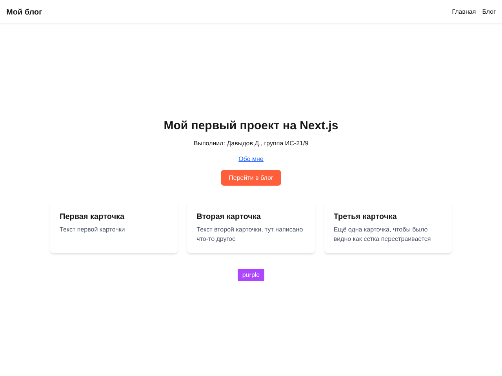
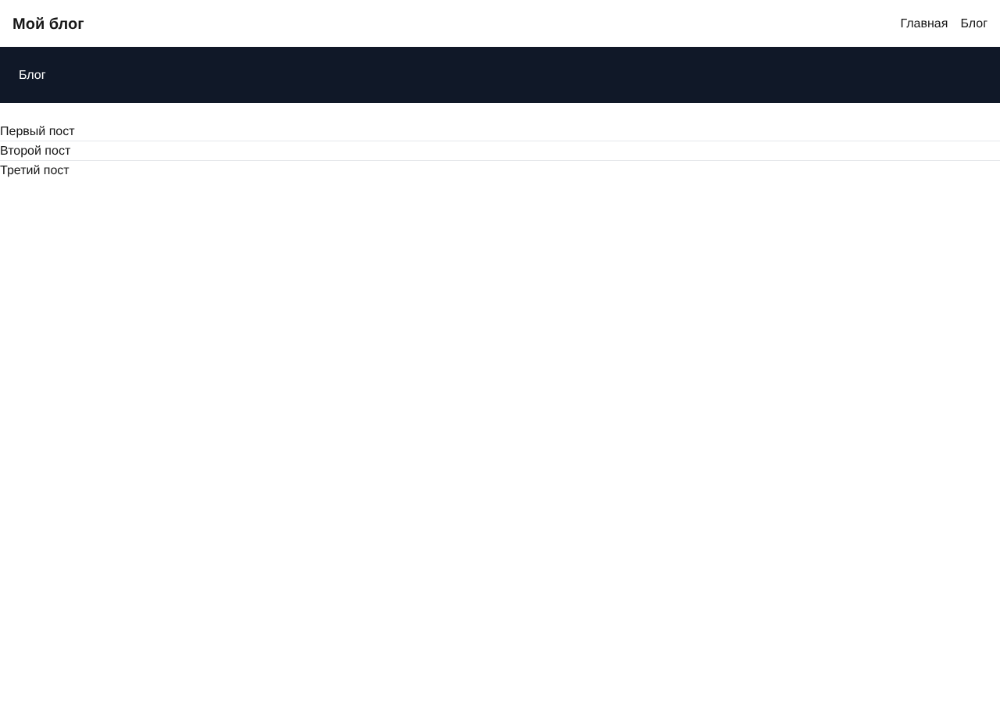
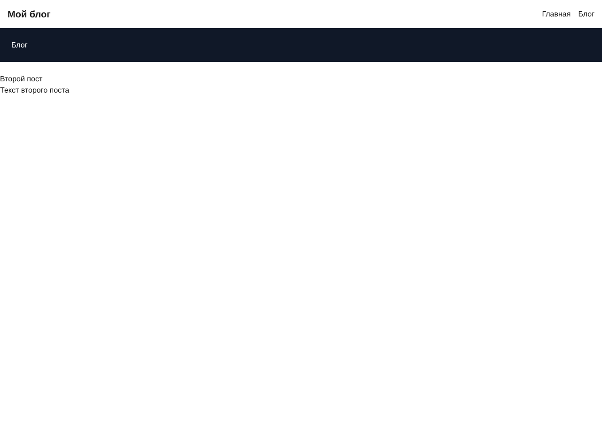
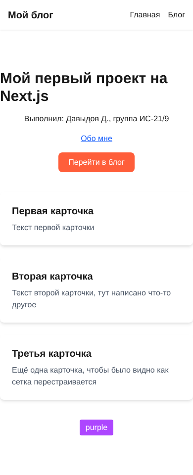

# МДК.05.01 - практические работы

Next.js проект (App Router, TypeScript, Tailwind)

## ПЗ 1 - введение в Next.js

- главная страница app/page.tsx
- страница /about
- ссылка между страницами через next/link

## ПЗ 2 - компоненты и навигация

- компонент components/Card.tsx с пропсами
- раздел /posts со списком постов + общий layout
- динамический маршрут /posts/[id]
- ссылки из списка на отдельные посты

## ПЗ 3 - Tailwind CSS

## запуск

npm install
npm run dev
